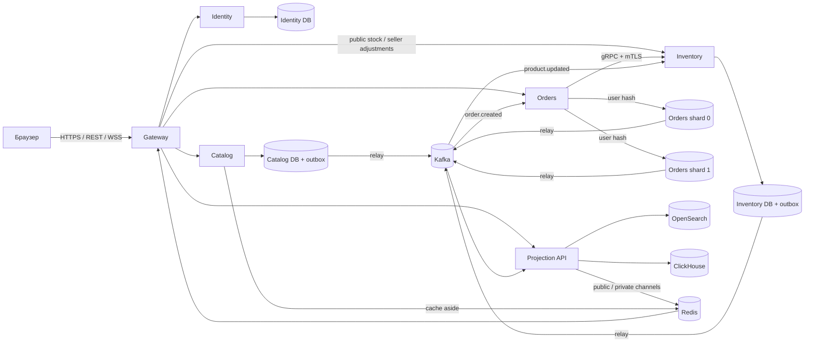

# mesto / FlashCart — развёртывание, архитектура, нагрузка и масштабирование

Руководство для разработчика и инженера сопровождения. Состояние кода проверено 8 ноября 2026 года. Пользовательские действия описаны в [USER_GUIDE.md](USER_GUIDE.md).

**Текущий результат:** работающий marketplace-сценарий с шестью Go-сервисами, Docker Compose и Kubernetes-манифестами. Функциональность и конкурентные инварианты проверены тестами. Предельная длительно поддерживаемая нагрузка текущей marketplace-версии ещё не измерена. Ниже отдельно приведены исторический benchmark, расчёт по коду и план определения реальной capacity.

## 1. Стек и назначение компонентов

Версии взяты из `go.mod`, `Dockerfile`, `compose.yaml` и генератора манифестов; это закреплённые версии проекта, а не утверждение о последних доступных релизах.

| Компонент | Версия / реализация | Для чего используется |
|---|---|---|
| Go | module требует 1.25.0+, Docker build — 1.25.5 | HTTP, WebSocket, бизнес-операции, consumers, SQL-транзакции |
| PostgreSQL | 17.6-alpine | Пользователи, каталог, остатки, заказы, idempotency, inbox/outbox |
| Apache Kafka | 4.1.2, KRaft | Асинхронный workflow заказов, выделение initial stock, доставка изменений |
| Redis | 7.4.6-alpine | Cache aside, rate limits, одноразовые WS tickets, Pub/Sub |
| OpenSearch | 3.3.2 | Полнотекстовая проекция товаров, index `products-v2` |
| ClickHouse | 25.8.3.66-alpine | История событий заказов и агрегированная статистика |
| Prometheus | 3.7.3, необязательный Compose profile | HTTP/Go/process metrics и базовое правило ошибок |
| gRPC / Protobuf | grpc-go 1.75.1, protobuf-go 1.36.9 | Типизированный внутренний Inventory Reserve с mTLS |
| HTTP / REST / JSON | Go `net/http` | Публичные ресурсы и внутренние HTTP-вызовы |
| WebSocket | `github.com/coder/websocket` 1.8.14 | Публичное наличие и приватные изменения заказов |
| Аутентификация | Ed25519 JWT, bcrypt, refresh rotation | Проверка личности, ролей и срока сессии |
| Контейнеризация | Docker multi-stage, Alpine runtime | Раздельные service images, non-root UID 10001 |
| Оркестрация | Kubernetes, Kustomize, kind для локального стенда | Deployments, StatefulSets/PVC, probes, HPA, NetworkPolicy |

Статическая витрина встроена в Gateway через `go:embed`. Отдельный Node.js build для запуска сайта не нужен. Фотографии, SVG и стили локальные; обязательных внешних CDN нет.

## 2. Архитектура и владение данными



| Сервис | Ответственность | Собственные данные |
|---|---|---|
| `gateway` | TLS edge, reverse proxy, Origin policy, rate limiter, WS tickets, fanout | Redis tickets/counters; сокеты и bounded queues в памяти |
| `identity` | Регистрация customer/seller, admin bootstrap, login, refresh/logout, профиль | `users`, `refresh_tokens` |
| `catalog` | Seller-owned listings, metadata/price, идемпотентная публикация | `products`, `product_requests`, `outbox` |
| `inventory` | Initial allocation, атомарный reserve, seller adjustments, public snapshots | `stock`, `reservations`, `stock_adjustments`, `outbox` |
| `orders` | Checkout, owner routing, orchestration, buyer/seller views | `orders`, `idempotency`, `inbox`, `outbox` на каждом shard |
| `projection` | Независимые Kafka consumers поиска, аналитики и уведомлений | Перестраиваемые read models OpenSearch/ClickHouse |

В dev Identity, Catalog и Inventory используют отдельные БД/роли на одном PostgreSQL instance. Orders использует два других PostgreSQL instance с независимыми volumes. Всего три PostgreSQL instance, пять logical databases. Совместный host трёх БД — общий failure domain; межсервисного доступа к чужим таблицам в handlers нет.

### 2.1. Покупка ограниченного товара

1. Gateway принимает JWT и checkout; Orders проверяет его самостоятельно.
2. Orders нормализует items, получает buyer ID из claims и выбирает owner shard.
3. В транзакции берётся advisory lock `(user, key)`, проверяется canonical payload hash. Повтор возвращает прежний заказ; изменённое тело с тем же ключом даёт `409`.
4. Сервер получает цены и seller metadata из Catalog, сохраняет price/name/seller snapshots, order `pending`, idempotency и `order.created` outbox. После commit возвращает `202`.
5. Relay публикует событие. Orders consumer вызывает Inventory Reserve с неизменным order ID.
6. Inventory блокирует SKU в отсортированном порядке, проверяет все количества и в одной транзакции сохраняет решение, изменения stock/version и stock outbox. Частичного резерва нет.
7. Orders переводит `pending` в `confirmed` либо `rejected` через условный update, сохраняет inbox и terminal outbox; затем коммитит consumer offset.
8. Projection обновляет аналитику и уведомления. Buyer видит свой order, seller — только свои строки и subtotal. Public WSS получает только product/stock events.

Если ответ Inventory потерялся после commit, повторный RPC вернёт прежнее reservation decision. Повтор Kafka record после Orders commit не выполняет новый reserve. Это at least once с идемпотентными операциями, а не end-to-end exactly once.

### 2.2. Публикация и пополнение товара

Catalog сохраняет товар и `product.updated` атомарно. Inventory consumer `inventory-products-v1` создаёт stock через `INSERT ... ON CONFLICT DO NOTHING`: повтор сообщения или изменение описания не пополняют уже проданные единицы.

Seller adjustment — прибавление/списание `delta`, а не установка абсолютного остатка по устаревшему snapshot. Он блокирует ту же stock row, что и покупка. Область idempotency — `(seller_id, key)`, итоговый stock ограничен 0..1 000 000. Версия и `stock.updated` фиксируются вместе с количеством.

### 2.3. Проекции, realtime и деньги

- OpenSearch применяет product version через `external_gte`; более старый event не откатывает карточку. Поиск eventual consistent.
- ClickHouse использует `ReplacingMergeTree(version)` с event ID. Summary читает `FINAL`, иначе возможен повторный учёт до фонового merge.
- Redis Pub/Sub не хранит историю пропущенных уведомлений. Browser сравнивает version и периодически перечитывает REST snapshots. Такая компенсация нужна из-за at-most-once семантики Pub/Sub. [Документация Redis](https://redis.io/docs/latest/develop/pubsub/).
- Public stream `/ws/catalog` доступен без JWT. Private `/ws` требует одноразовый ticket, живёт до expiry JWT и не смешивает данные покупателей/продавцов.
- Новые цены/заказы — RUB в целых копейках, при сохранённых API-именах `price_cents` и `total_cents`. Legacy orders маркированы USD. Аналитика RUB исключает другую валюту.

### 2.4. Шардирование

Router: `FNV1a32(user_id) % 2`. Все order-side records пользователя colocated: orders, idempotency, inbox и outbox. Buyer reads требуют один shard. Seller sales выполняют ограниченный fanout в оба shard, фильтруют JSONB items с GIN index и объединяют последние 50 результатов.

Функция topology v1 зафиксирована тестом. Замена `% 2` на `% 4` без переноса данных направит часть пользователей в другую БД. Replica PostgreSQL, новый Kafka partition и новый order shard решают разные задачи и не взаимозаменяемы.

## 3. Развёртывание через Docker Compose

### 3.1. Требования

- Docker Engine и Compose v2; на Windows — Docker Desktop в режиме Linux containers.
- Для полного dev stack начните с 4–8 vCPU, 8–12 GiB RAM Docker VM и минимум 10 GiB свободного диска. Это стартовый ресурсный ориентир, не подтверждённая capacity.
- Go 1.25+ нужен для локальных команд разработки и smoke; для запуска только контейнеров используйте `scripts/up.*`.
- Выполняйте команды из корня репозитория. Первый запуск скачивает крупные образы и требует интернета.

### 3.2. Вариант без установленного Go

PowerShell:

```powershell
.\scripts\up.ps1
```

Linux/macOS:

```bash
sh scripts/up.sh
```

Скрипт при отсутствии `.env` собирает `Dockerfile.bootstrap`, создаёт credentials/certificates и выполняет `docker compose up --build -d --wait`. Linux-скрипт запускает bootstrap с UID/GID текущего пользователя.

### 3.3. Вариант с Go

```sh
go run ./cmd/bootstrap
docker compose config --quiet
docker compose up --build -d --wait --wait-timeout 240
docker compose ps
```

Адрес: [https://localhost:8443](https://localhost:8443/). В штатном Compose только этот порт привязан к loopback; базы и брокер на host не опубликованы. Prometheus при включении профиля доступен отдельно на loopback:9091.

Bootstrap создаёт `.env` и `.secrets/`, исключённые из Git/build context. Каждый DB owner имеет свой пароль; приложение не использует общий PostgreSQL superuser. Private JWT key монтируется только Identity; validators получают public key. CA/private service keys нельзя включать в архив исходников.

Локальный CA не является публично доверенным. Smoke читает `.secrets/ca.pem` и проверяет цепочку. Для рабочего домена нужны сертификат с корректным SAN и `PUBLIC_ORIGIN`, точно совпадающий с адресом браузера. Изменение Origin без нового подходящего TLS certificate не завершает настройку домена.

### 3.4. Проверка готовности

```sh
docker compose ps -a
docker compose logs --tail=80 identity catalog inventory orders projection gateway
go run ./cmd/smoke
```

Постоянно работают 6 приложений и 7 infrastructure containers; `kafka-init` должен завершиться с кодом 0. Healthcheck приложений использует `/readyz`; Gateway — служебный HTTP port 8081, прочие — 8080. `unhealthy` в Docker сам по себе не означает автоматический restart контейнера.

Smoke предназначен для собственного dev/staging dataset: создаёт пользователей, заказы и расходует stock. Marketplace-проверка дополнительно создаёт seller listings и делает restock.

PowerShell:

```powershell
$env:MARKETPLACE_CHECK = '1'
try { go run ./cmd/smoke } finally { Remove-Item Env:MARKETPLACE_CHECK }
```

Bash:

```bash
MARKETPLACE_CHECK=1 go run ./cmd/smoke
```

### 3.5. Остановка и обновление

```sh
docker compose stop
docker compose start
docker compose up --build -d --wait --wait-timeout 240
docker compose down
```

`stop/down` сохраняют named volumes. `down -v` удаляет данные; это команда намеренного сброса своего dev dataset, не процедура обычного обновления.

Перед обновлением сохраняйте исходные `.env`/ключи и делайте backup БД. Bootstrap при существующем `.env` ничего не пересоздаёт. Изменение `.env` не является универсальной процедурой ротации: пароль существующей PostgreSQL-роли и хэш существующего admin нужно менять в их хранилищах; server/client credentials Redis и ClickHouse обновляются согласованно. Утерянные файлы ключей восстанавливаются отдельно.

SQL migrations встроены в бинарник, сериализованы advisory lock и проверяются checksum. Применённые файлы не редактируются: добавляется следующая migration. `.gitattributes` фиксирует LF для SQL. Rollback старого binary поверх новой схемы допустим только после проверки совместимости; механизма автоматического down migration нет.

## 4. Развёртывание Kubernetes

### 4.1. Что подготовлено и что проверено

В `deploy/` находятся Namespace, 6 Deployments, 7 StatefulSets/PVC, Services, Kafka init Job, HPA, PDB и NetworkPolicy. Повторяющиеся объекты генерируются `cmd/manifests` в `deploy/k8s/generated.json`; custom network policy хранится отдельно.

В предыдущей проверке все **46 ресурсов** прошли строгую schema validation. Реальный rollout в Kubernetes, enforcement CNI, storage recovery и работа HPA в кластере пока не подтверждены. Эти результаты нельзя заменять успешным Kustomize render.

### 4.2. Локальный kind

Нужны Go, Docker, kind, kubectl, доступный StorageClass. Проверьте выбранный context:

```sh
kubectl config current-context
kind create cluster --name flashcart --config deploy/kind.yaml
```

PowerShell:

```powershell
.\scripts\kube-up.ps1 -KindCluster flashcart
```

Bash:

```bash
KIND_CLUSTER=flashcart sh scripts/kube-up.sh
```

Скрипт собирает 6 образов, загружает их в kind, создаёт namespace/Secrets из локальных файлов, применяет Kustomize и ожидает Kafka Job/rollouts. Он изменяет **текущий** kubectl context.

Kind configuration привязывает host `127.0.0.1:8443` к NodePort 30443. Compose Gateway на том же порту перед запуском kind нужно остановить. Альтернатива доступу через NodePort:

```sh
kubectl -n flashcart port-forward svc/gateway 8443:443
kubectl -n flashcart get pods,pvc,hpa,pdb
kubectl -n flashcart rollout status deployment/orders
```

Стандартный kind не доказывает применение NetworkPolicy: нужен CNI с соответствующей поддержкой. HPA по CPU требует Metrics Server и корректных resource requests. Это зависимости кластера, а не автоматически устанавливаемые части проекта. [Документация HPA](https://kubernetes.io/docs/concepts/workloads/autoscaling/horizontal-pod-autoscale/).

### 4.3. Удалённый кластер

Базовые `flashcart/<service>:dev` доступны только локально. Скрипт `kube-up` не выполняет push в registry. Для удалённого deployment:

1. Соберите каждый образ с `--build-arg SERVICE=<service>`.
2. Присвойте release tag, опубликуйте в своём registry и настройте pull access.
3. Создайте overlay, меняющий все 6 image references, и обеспечьте те же имена Secrets.
4. Выделите storage с нужной durability/capacity; dev PVC по 2 GiB не являются production sizing.
5. Настройте домен, внешние certificates, Origin и ingress/LB; сохраните private services закрытыми.
6. Выполните rollout, дождитесь готовности, затем проверьте smoke на отдельном тестовом dataset.

Пример image override для **создаваемого оператором** `deploy/overlays/production/kustomization.yaml`:

```yaml
apiVersion: kustomize.config.k8s.io/v1beta1
kind: Kustomization
resources:
  - ../..
images:
  - name: flashcart/gateway
    newName: registry.example.com/mesto/gateway
    newTag: '2026-11-08.1'
  - name: flashcart/identity
    newName: registry.example.com/mesto/identity
    newTag: '2026-11-08.1'
  - name: flashcart/catalog
    newName: registry.example.com/mesto/catalog
    newTag: '2026-11-08.1'
  - name: flashcart/inventory
    newName: registry.example.com/mesto/inventory
    newTag: '2026-11-08.1'
  - name: flashcart/orders
    newName: registry.example.com/mesto/orders
    newTag: '2026-11-08.1'
  - name: flashcart/projection
    newName: registry.example.com/mesto/projection
    newTag: '2026-11-08.1'
```

`registry.example.com` и tag — пример: замените их собственным registry/release, предпочтительно immutable digest. Этот overlay меняет только images; security, HA и production storage он не добавляет.

Нужные Secrets: `app-secrets`, `jwt-signing`, `jwt-verifier`, `gateway-tls`, `grpc-inventory`, `grpc-orders`. Точные file mappings приведены в [kube-up.sh](scripts/kube-up.sh). В рабочем кластере используйте управляемый источник secrets вместо передачи dev `.env` как постоянной схемы управления доступом.

После изменения Secret с сертификатом нужен restart соответствующего Deployment: key files смонтированы через `subPath`. Изменение исходников/загрузка нового `:dev` image также не инициирует rollout сама по себе; используйте release image update.

## 5. Конфигурация и границы безопасности

| Настройка | Назначение |
|---|---|
| `DATABASE_URL` | Собственная PostgreSQL DB для Identity/Catalog/Inventory |
| `ORDERS_SHARD_0_URL`, `ORDERS_SHARD_1_URL` | Два фиксированных owner shards |
| `JWT_PRIVATE_KEY`, `JWT_PUBLIC_KEY` | Файлы ключей, private только у Identity |
| `GRPC_CA`, `GRPC_CERT`, `GRPC_KEY` | mTLS Inventory/Orders; SAN URI клиента должен быть `spiffe://flashcart/orders` |
| `REDIS_URL` | Cache/rate limits/tickets/PubSub |
| `KAFKA_BROKERS` | Brokers; default `kafka:9092` |
| `OPENSEARCH_URL`, `CLICKHOUSE_URL` | Адреса read-model хранилищ |
| `CLICKHOUSE_USER`, `CLICKHOUSE_PASSWORD` | Доступ к аналитике |
| `PUBLIC_ORIGIN` | Единственный разрешённый browser Origin; default `https://localhost:8443` |
| `HTTP_TLS_CERT`, `HTTP_TLS_KEY` | TLS edge |
| `ADMIN_EMAIL`, `ADMIN_PASSWORD` | Первичное создание admin, не последующая смена пароля |
| `RATE_LIMIT_PER_MINUTE`, `AUTH_RATE_LIMIT_PER_MINUTE` | Default 120 API/WS handshakes и 20 login/register/refresh на socket IP в минуту |

Имена DB URL в корневом `.env` преобразуются Compose в service env. `.env` не нужно целиком экспортировать в окружение каждого процесса: некоторые ключи имеют другой смысл на уровне service endpoints.

JWT живёт 10 минут, refresh family — до 7 дней без sliding extension. Refresh хранится hash-only, rotation/reuse сериализованы по family. Logout отзывает refresh family; уже выпущенный access token остаётся действителен до expiry. Admin signup запрещён; seller ownership не передаётся клиентом.

В dev внутренние HTTP/PG/Kafka идут без TLS, OpenSearch security plugin отключён, stateful dependencies одиночные. Для внешней эксплуатации требуются TLS/service authentication, broker ACL/SASL, защищённый OpenSearch, backup/PITR, secret/PKI rotation и проверенная HA topology. App containers non-root/read-only не заменяют эти компоненты.

Rate limiter использует RemoteAddr и не доверяет пользовательскому `X-Forwarded-For`. За ingress сначала настройте доверенные proxy и корректную client-IP policy: иначе клиенты ingress делят общий IP limit. При Redis outage gateway API закрывается с `503`.

## 6. Административные операции

Отдельного admin UI нет. На уровне API доступны admin-only изменения общего каталога и analytics. Admin не получает универсальный обход owner checks Inventory или просмотр всех чужих заказов.

### 6.1. Получить доступ

При первичной инициализации Identity создаёт `ADMIN_EMAIL` с bcrypt-хэшем `ADMIN_PASSWORD`. При конфликте email существующая запись не повышается до admin и не получает новый пароль.

Вызовите `POST /api/auth/login` с email/password из своего защищённого источника credentials. Ответ содержит короткоживущий `access_token`. Проверить роль можно через `GET /api/auth/me` с `Authorization: Bearer ...`. Тела login и tokens не сохраняйте в Git/обычных диагностических логах.

Пример обращения из PowerShell, когда token уже получен:

```powershell
$adminAccessToken = Read-Host 'Access token администратора'
curl.exe --cacert .secrets/ca.pem -H "Authorization: Bearer $adminAccessToken" https://localhost:8443/api/auth/me
curl.exe --cacert .secrets/ca.pem -H "Authorization: Bearer $adminAccessToken" https://localhost:8443/api/analytics/summary
```

На рабочем домене с публично доверенным сертификатом отдельный dev CA не нужен.

### 6.2. Изменить общий каталог

1. Прочитайте `GET /api/products/{sku}`.
2. Подготовьте полный набор редактируемых полей: `name`, `price_cents`, `old_price_cents`, `description`, `category`, `image_key`.
3. Передайте их в `PUT /api/products/{sku}` с admin token. Пропуск полей в этом `PUT` может заменить их значениями по умолчанию; это не частичный PATCH.
4. Проверьте новую version в ответе, карточку и eventual search update.

Owner/SKU/initial allocation не меняются этим действием. Stock adjustment разрешён владельцу SKU через seller API; обхода этого ограничения для admin сейчас нет.

### 6.3. Прочитать сводку

`GET /api/analytics/summary` возвращает `created`, `confirmed`, `rejected`, `revenue_cents`, `report_currency=RUB`. 64-bit числа ClickHouse могут быть представлены JSON-строками. Revenue — сумма подтверждённых заказов, а не факт payment capture.

Сводка eventual consistent, агрегируется по истории, доступной в ClickHouse, и фильтрует RUB. Она не должна интерпретироваться как бухгалтерский или платёжный отчёт.

## 7. Тестирование и подтверждённые результаты

```sh
go vet ./...
go test -count=1 ./...
go build ./...
docker compose -f compose.yaml -f compose.test.yaml run --build --rm tests
go run ./cmd/smoke
```

Linux test runner содержит C toolchain и использует race detector. Integration tests создают случайные schemas собственного тестового PostgreSQL; рабочие schemas не сбрасываются. В GitHub Actions дополнительно описаны Compose startup и оба smoke-сценария.

Подтверждены конкурентный reserve, idempotent checkout/listing/restock, lost RPC reply recovery, seller ownership, скрытие чужих lines и refresh reuse revocation. Marketplace E2E создаёт 2 продавцов/3 покупателей: stock=2 даёт 2 confirmed и 1 rejected; проверяются public/private WSS и mixed-seller order.

Подробности и provenance: [MARKETPLACE.md](docs/MARKETPLACE.md), [VALIDATION.md](docs/VALIDATION.md). В этом изменении документации повторный runtime/load run не выполнялся.

## 8. Примерная максимальная нагрузка

### 8.1. Что действительно измерено

Исторический прогон **первой версии, до добавления seller/stock events**, 7 ноября 2026:

| Показатель | Результат |
|---|---:|
| Docker VM | 32 vCPU, около 30,2 GiB RAM |
| App replica | По одной, limit 1 CPU / 256 MiB |
| Время / workload | ~70,7 sec, до 30 configured VUs, 1 buyer / 1 SKU |
| Созданные заказы | 2 078; в среднем 29,41 новых orders/sec |
| Все HTTP calls | 120,74 requests/sec, включая replay/poll/login |
| HTTP errors | 0 / 8 532 |
| Create p95 | 4,87 ms |
| Convergence p95 | 511 ms, измерено polling с шагом 250 ms |
| Результаты load cohort | 998 confirmed, 1 080 rejected после исчерпания stock |

Это не 120 успешных покупок/сек и не измеренный максимум. VU workload закрытый, прогон короткий, оба физических shard не нагружались равномерно, p99/soak/WAN/массовые WSS не измерялись. После расширения marketplace новый capacity benchmark не выполнялся.

### 8.2. Расчёт по текущему коду

Ниже **аналитическая оценка**, не результат испытания. Предположения: по одной replica приложения; оба Orders shard получают равную нагрузку; все заказы подтверждаются; нет сбоев, replay overhead, публикаций новых товаров и restock. Время SQL/сети для получения идеальной верхней границы условно равно нулю.

В [events.go](internal/platform/events.go) один relay берёт до 20 outbox rows, затем после batch ждёт 200 ms:

```text
Идеальный бюджет одного relay: 20 / 0,2 = 100 событий/сек.
Orders: 2 события на заказ — created + terminal.
Два Orders relay, по одному на shard: 2 × 100 / 2 = 100 заказов/сек.
Если все покупатели попали в один shard: 100 / 2 = 50 заказов/сек.
Inventory: k stock events на подтверждённый заказ из k разных SKU.
Один Inventory relay: 100 / k подтверждённых заказов/сек.
```

| Корзина / распределение | Идеальный relay-бюджет полного потока |
|---|---:|
| 1 SKU, равномерно по двум Orders shard | До ~100 confirmed orders/sec |
| 2 разных SKU, равномерно | До ~50 confirmed orders/sec |
| 5 разных SKU, равномерно | До ~20 confirmed orders/sec |
| 1 SKU, все записи в один Orders shard | До ~50 confirmed orders/sec |

`k` — разные SKU, не количество штук одного SKU. Реальные SQL commits, broker acknowledgements, lock waits и consumers снижают этот бюджет. Увеличение replicas создаёт дополнительные relay и меняет расчёт; оно не устраняет горячий stock row и downstream limits.

**Практический ориентир для планирования текущего одно-replica стенда — нагрузка порядка десятков новых заказов в секунду с последующим измерением.** Для полного потока 1–2 SKU видимый по коду идеальный relay ceiling — примерно 50–100 confirmed orders/sec при равномерных shard; считать его гарантированной capacity нельзя. Начните staircase-тест с 10 orders/sec, затем 20, 30 и выше до обнаружения устойчивого ограничения.

Чистый read RPS и максимальное количество одновременных WebSocket connections не определены. Их нельзя вывести из 30 VUs или числа Kafka partitions. Уже 1 000 активных вкладок при stock polling раз в 10 sec дают минимум около 100 stock GET/sec, плюс периодические catalog reads и покупки.

### 8.3. Что ограничит раньше

| Ограничение | Последствие | Следующий инженерный шаг |
|---|---|---|
| Hot SKU row lock | Покупки одной позиции сериализуются | Измерить lock hold; single writer/escrow buckets при необходимости |
| Quote HTTP внутри checkout transaction | Долгое удержание DB pool при корзине до 20 SKU | Batch quote, версионированный quote contract, короткая write transaction |
| Outbox 20 / 200 ms | Растут backlog и convergence | Batch/lease tuning или CDC, затем повторить failure tests |
| CH insert на каждый order event | Накопление маленьких parts и merge pressure | Batch ingestion или async inserts с подтверждённым flush |
| 4 saga readers × Orders replica, topic 12 partitions | После 3 replicas появляются лишние group members | Разделить HTTP/worker sizing; больше partitions только после оценки порядка |
| Каждая Projection group читает общий topic | Дополнительная работа даже для пропуска чужих event types | Разделение domains/topics и отдельные deployables |
| Public fanout на каждого посетителя | Network/CPU растут с active subscribers | Адресные product subscriptions, coalescing, quotas/resume |
| Shared Redis | Общая точка отказа cache/security/realtime | Разнести workloads и настроить failover |
| Нет retention cleanup | Рост tables/volumes с каждым заказом | Согласовать retry/replay horizon и безопасный purge/archive |

При 100 orders/sec получается 8,64 млн orders/day и минимум 17,28 млн order outbox rows/day до очистки. Это расчёт объёма, не подтверждение способности текущей версии обслуживать такой день.

## 9. Как масштабировать при высокой нагрузке

### 9.1. Сначала определить вид насыщения

Сопоставляйте HTTP latency/error ratio, terminal convergence, Kafka lag, oldest outbox age, DB pool/lock wait, CPU/RSS, дисковую задержку, CH parts/merge и активные sockets. Низкий latency `202` при постоянно растущем pending backlog означает перегрузку полного workflow.

| Симптом | Что проверить и масштабировать |
|---|---|
| CPU Gateway, много sockets, backend свободен | Gateway replicas, LB, socket admission, fanout routing |
| Медленный login | CPU Identity и bcrypt; отдельный auth scaling/abuse policy |
| Catalog read load | Cache hit/miss, индексы, list caching/read model; затем replicas |
| Растёт Orders Kafka lag | Assigned partitions, RPC latency, workers; не только CPU Orders |
| Один SKU задерживает резерв | Inventory row lock/commit time; дополнительные HTTP pods могут не помочь |
| Растёт stock outbox при быстрых reserves | Relay capacity и Kafka publishing |
| CH consumer отстаёт | Insert batching, parts/merge, disk; HTTP replicas проблему не решают |
| Везде 429 или 503 за ingress | Real client IP, rate limits и Redis availability |

### 9.2. Доступное масштабирование приложений

В Kubernetes HPA уже описан для `gateway`, `catalog`, `orders`: 1–4 replicas, target CPU 70%, scale-down stabilization 120 sec. Request 100m означает, что target около 70m CPU на pod; это доля request, а не limit 1 CPU. Проверьте sizing requests по профилю. Metrics Server устанавливается отдельно. [Механика HPA](https://kubernetes.io/docs/concepts/workloads/autoscaling/horizontal-pod-autoscale/).

Для временного staging-эксперимента с 2–3 Orders pods, PowerShell:

```powershell
New-Item -ItemType Directory -Force artifacts | Out-Null
@'
spec:
  minReplicas: 2
  maxReplicas: 3
'@ | Set-Content -Encoding utf8 artifacts/orders-hpa.patch.yaml
kubectl -n flashcart patch hpa orders --type=merge --patch-file artifacts/orders-hpa.patch.yaml
kubectl -n flashcart get hpa,pods
kubectl -n flashcart top pods
```

Для постоянного изменения обновите generator/overlay и применяйте его через свой release process. Обычный `kubectl scale` при активном HPA может быть переопределён контроллером. На 4 Orders pods приходится 16 readers при 12 partitions; часть readers будет без assignment, хотя дополнительные pods ещё могут обслуживать HTTP.

Identity/Inventory/Projection допускают отдельные Deployment replicas, но для них HPA в базе не настроен. Сначала измерьте зависимости и задайте min/max/resource budget. Projection replicas помогают group parallelism до partition/downstream bottleneck; разделение трёх sinks в отдельные deployables даст более точное управление ресурсами.

Для локального эксперимента Compose:

```sh
docker compose up -d --scale catalog=2 --scale orders=2 --scale inventory=2 --scale projection=2
```

У Gateway фиксирован host-port 8443: несколько Compose Gateway replicas требуют отдельного proxy/LB и изменения port mapping. В Kubernetes общий Service решает эту задачу. Sticky sessions для восстановления WS не обязательны: tickets общие в Redis, новый Gateway восстанавливает связь, browser перечитывает snapshots. Durable resume пока отсутствует.

### 9.3. Бюджет БД и тяжёлые процессы

`pgxpool.MaxConns=12` на service DB. Одна Orders replica имеет два pools — до 12 на каждый shard. Четыре Orders replicas дают до 48 connections на **каждый** Orders DB. На shared PG отдельно суммируются Identity/Catalog/Inventory pools всех replicas. Pool limit не равен желательному числу постоянно занятых соединений.

Перед ростом replicas измерьте DB max connections, pool waits, IOPS и lock time. При необходимости используйте connection pooling и отдельные PG hosts; рост числа клиентов может ухудшить throughput. Read replicas не масштабируют write-side stock reservation. Предел hot SKU зависит от времени удержания одной stock row до commit.

### 9.4. Outbox и Kafka

Пачка/пауза relay сейчас заданы в Go-коде; environment-настроек для них нет. Изменение требует сборки и тестирования. Увеличивать batch бесконечно нельзя: publish держит SQL locks, batch deadline 4 sec, writer timeout 3 sec. Следующий вариант — claim/lease с короткими transactions или CDC.

Для отказоустойчивости проектируйте многоброкерную topology с RF=3, `min.insync.replicas=2` и producer `acks=all`. Запись требует достаточного ISR; `acks=all` ждёт всех текущих in-sync replicas. Dev RF=1 этого свойства не даёт. [Kafka topic configs](https://kafka.apache.org/41/configuration/topic-configs/).

Добавление partitions увеличивает доступный consumer parallelism, но не исправляет Inventory serialization. Hash-routing ключей меняется при изменении partition count: для stateful ordering нужен согласованный переход/новый topic с drain/cutover, а не предположение о глобальном порядке. Доменную poison-message quarantine, retry topics и backlog-age alerts ещё нужно реализовать.

### 9.5. ClickHouse, поиск и realtime

ClickHouse рекомендует уменьшать частоту маленьких inserts и использовать batching; официальный ориентир для синхронных batches — от 1 000 rows. Для низкого потока batch size нужно сочетать с ограниченным flush interval либо использовать async inserts. Коммитить Kafka offset следует после подтверждённого сохранения/flush, не после помещения в недолговечный буфер. [Insert strategy](https://clickhouse.com/docs/concepts/best-practices/selecting-an-insert-strategy).

В текущем коде batching не реализован; `FINAL` обеспечивает корректность dedup summary, но его стоимость нужно измерить на большом наборе. Новые агрегаты/materialized views обязаны учитывать дубли до merge. Добавление replicated/distributed CH и Keeper — отдельная инфраструктурная работа.

OpenSearch имеет 3 primary shards и 0 replicas в dev. Размещение на нескольких data nodes с replicas помогает HA/read throughput; слишком много мелких shards может увеличить overhead. Sizing делайте по объёму/refresh/search profile, а не по числу app pods.

Для большого realtime fanout нужны подписки на интересующие SKU, coalescing частых stock changes, лимит connections/user/node, presence-aware private routing и resume cursor. Сейчас каждая Gateway replica получает весь Redis stream, затем рассылает локальным sockets. Queue 32 может пропускать updates медленного клиента; periodic snapshot — часть корректности UI.

Разнесите Redis security/tickets/rate limits и cache/realtime по отдельным failure domains/ACL. Простая замена адреса на Redis Cluster без проверки clients и channel routing не является завершённой миграцией.

### 9.6. Рост числа физических Orders shards

Переход на 4+ shard требует изменения модели routing:

1. Ввести virtual buckets/directory и routing epoch.
2. Перенести orders, idempotency, inbox, outbox пользователя совместно.
3. Обеспечить catch-up и единственного writer с fencing; не допустить двух активных owner.
4. Сверить counts/checksums и in-flight reservations.
5. Атомарно переключить routing, оставить проверенный rollback/read fallback window.

Для первой миграции допустим bounded maintenance window. Online resharding не реализован. Подробные tradeoffs — в [ARCHITECTURE.md](docs/ARCHITECTURE.md).

## 10. Как определить реальный максимум

1. Зафиксировать commit, hardware, limits, replicas, DB settings, partitions, dataset и долю confirmed/rejected.
2. Прогреть стенд; дать много buyer IDs и SKU, чтобы проверить оба shard. Отдельно прогнать hot-SKU и большие корзины.
3. Использовать open arrival-rate workload с ступенями 10 → 20 → 30 orders/sec и далее; текущий VU k6 script оставить как regression scenario.
4. На каждой ступени дождаться steady state: стабильные lag/backlog/память. Провести длительный soak, измерить p95/p99 и drain после burst.
5. Отдельно нагрузить reads, login, seller mutations и тысячи WS subscribers: эти профили имеют разные пределы.
6. Проверить correctness SQL и replay/recovery после отказов; быстрый ответ без сохранённого инварианта не считается успехом.

Пример критериев для начального эксперимента: create p95 <500 ms, terminal p95 <10 sec, HTTP 5xx <1%, отсутствие потерянных/дублированных заказов и отрицательного stock, backlog не растёт при постоянной подаче. Это предлагаемые критерии теста, не действующий production SLA.

Рабочий лимит выбирается ниже измеренного saturation knee с запасом на burst и потерю replica. Применяйте N−1 тест и фактическую утилизацию; не умножайте успешный RPS одного pod на количество pods без повторного полного workflow run.

## 11. Наблюдаемость, сбои и восстановление

```sh
docker compose --profile observability up -d prometheus
docker compose logs --tail=100 orders inventory projection
docker compose exec kafka /opt/kafka/bin/kafka-consumer-groups.sh --bootstrap-server kafka:9092 --describe --group orders-saga-v1
docker compose exec orders-db-0 psql -U orders -d orders -c "SELECT count(*), min(created_at) FROM outbox WHERE published_at IS NULL;"
docker compose exec orders-db-1 psql -U orders -d orders -c "SELECT count(*), min(created_at) FROM outbox WHERE published_at IS NULL;"
```

Prometheus: [http://localhost:9091](http://localhost:9091). Проверяйте также Catalog/Inventory outbox и группы `inventory-products-v1`, `projection-search-v2`, `projection-analytics-v1`, `projection-notifications-v1`.

Встроены HTTP counters/duration, event counters, Go/process metrics. Event counter не является числом реально записанных CH rows: consumers проходят общий topic и часть types пропускают. В Gateway HTTP duration включает долгоживущие WS handlers; общий GET p95 нельзя считать checkout latency. Для первичного create используйте k6 tag `phase:create` или добавьте отдельную route/use-case метрику.

| Отказ | Поведение текущего приложения |
|---|---|
| Kafka | Новые pending/outbox могут сохраняться; terminal workflow отстаёт |
| Inventory | Orders остаются pending, consumer повторяет Reserve |
| Redis | Gateway rate limiter fail-closed; public API 503, WS требуют восстановления |
| Один Orders shard | Owner reads/writes не проходят; coarse readiness обоих shard может убрать все Orders pods из Service |
| OpenSearch / CH | Read API Projection может быть неготов целиком; consumer groups имеют независимые retries |
| Gateway restart | Сокеты разрываются, browser переподключается и сверяет snapshots |

Нужны alerts на oldest pending/outbox age, group lag, error ratio, disk, pool/lock wait и CH parts. Автоматические exporters/адаптеры для всех этих метрик и distributed tracing пока не поставлены.

Volumes переживают container restart, но не являются backup. Для рабочей эксплуатации необходимы PG backup/WAL/PITR на каждом owner/shard, проверяемый restore, защищённая копия secrets и согласованное восстановление Orders/Inventory. Kafka retention ограничен; rebuild всей истории требует snapshot/archive, а не одного `--from-beginning`.

Не удаляйте reservation/idempotency/inbox раньше допустимого retry/replay window. Не помечайте outbox published вручную ради снижения lag. Сценарии отказов, безопасного replay и backup drill приведены в [RUNBOOK.md](docs/RUNBOOK.md).

## 12. Карта исходников и дальнейшие работы

| Задача | Исходники |
|---|---|
| Сборка/запуск | [Dockerfile](Dockerfile), [compose.yaml](compose.yaml), [scripts](scripts/) |
| K8s topology/resources/HPA | [cmd/manifests/main.go](cmd/manifests/main.go), [deploy](deploy/) |
| Outbox/consumer/retries | [events.go](internal/platform/events.go) |
| Pools/migrations | [db.go](internal/platform/db.go), [migrations](internal/platform/migrations/) |
| Shard routing/domain validation | [order.go](internal/domain/order.go) |
| Reserve/restock | [Inventory](internal/inventory/) |
| Seller ownership/snapshots | [Catalog](internal/catalog/), [Orders](internal/orders/) |
| Read models | [Projection](internal/projection/) |
| HTTP/WS/Origin/fanout | [Gateway](internal/gateway/) |
| Security controls | [SECURITY.md](docs/SECURITY.md), [auth.go](internal/platform/auth.go) |
| Контракты | [OpenAPI](api/openapi.yaml), [Protobuf](api/proto/inventory/v1/inventory.proto) |

Для дальнейшего развития приоритетны batch quote, batch projections/outbox tuning, durable WS recovery/admission, наблюдаемость backlog и HA/backups. Payment/cancel/expiry/release, moderation/KYC, user administration, uploads, pagination и online resharding — отдельные ещё не реализованные возможности.
