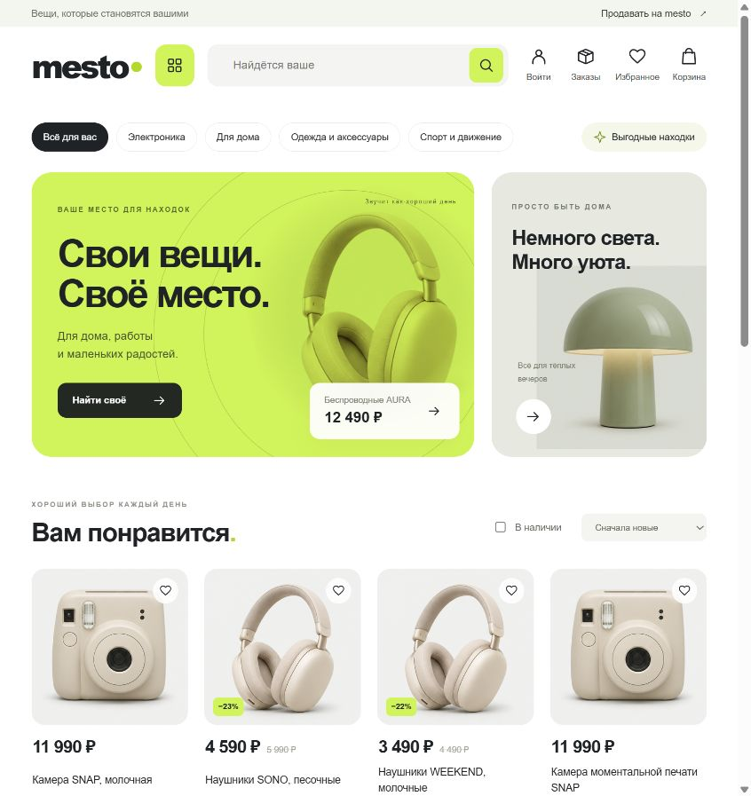
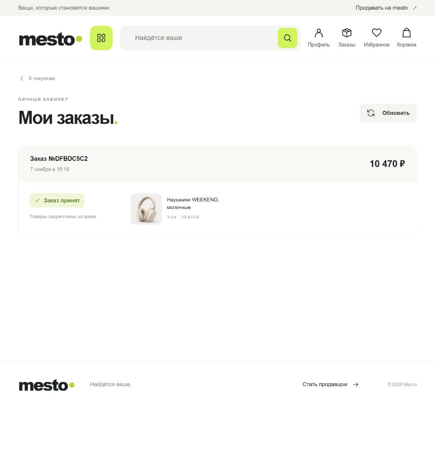
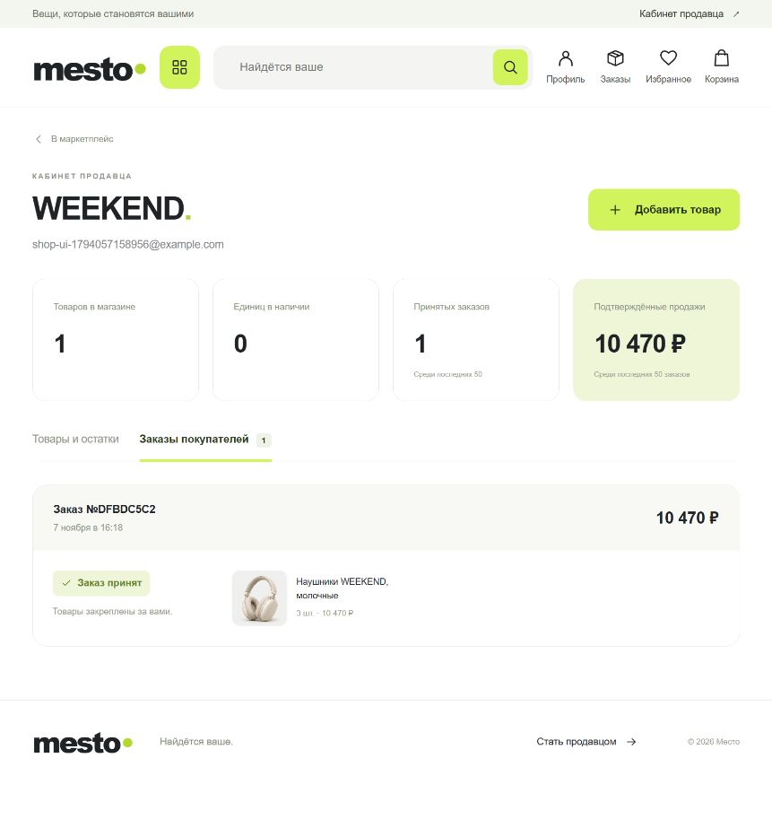

# mesto — руководство покупателя, продавца и администратора

Это руководство объясняет, как пользоваться сайтом. Развёртывание и сопровождение описаны отдельно в [техническом руководстве](TECHNICAL_GUIDE.md).

Актуально для версии приложения в этом репозитории на 8 ноября 2026 года.

## 1. Что можно делать в приложении

**mesto** — маркетплейс, на котором магазины публикуют товары, а покупатели оформляют заказы. Количество товаров ограничено. После покупки доступный остаток меняется у посетителей сайта; после пополнения товар снова появляется в продаже.

| Кто вы | Что доступно |
|---|---|
| Посетитель без входа | Смотреть товары, искать, выбирать категории и магазины, собирать корзину и избранное |
| Покупатель | Всё перечисленное, оформление заказов и просмотр своих покупок |
| Продавец | Покупки, собственный магазин, публикация и редактирование товаров, пополнение запаса, просмотр заказов своих товаров |
| Администратор | Обычные действия на сайте, работа со своими объявлениями и дополнительный служебный доступ к общему каталогу и сводной статистике |

В этой версии оформление закрепляет доступные товары за заказом. Банковская оплата, доставка, возвраты и отмена заказа ещё не подключены. Надпись «Заказ принят» означает, что товар выделен под заказ; она не означает списание денег или отправку посылки.

## 2. Как открыть сайт

Адрес сайта сообщает владелец приложения. При запуске проекта на своём компьютере используется [https://localhost:8443](https://localhost:8443/).

Если сайт недоступен, обратитесь к человеку, который его запустил. При предупреждении браузера о сертификате уточните у него правильный адрес и способ безопасного подключения.

На главной странице находятся:

- строка поиска;
- категории товаров;
- карточки с ценой, названием магазина и наличием;
- разделы «Войти» / «Профиль», «Заказы», «Избранное» и «Корзина»;
- кнопка «Продавать на mesto» для работы с магазином.

Нажатие на логотип mesto возвращает на главную страницу.

## 3. Регистрация и вход

### Создать аккаунт покупателя

1. Нажмите «Войти» в верхней части сайта.
2. Перейдите на вкладку «Создать аккаунт».
3. В поле «Я хочу» выберите «Покупать».
4. Введите email и пароль.
5. Нажмите «Создать аккаунт».

Для предсказуемого прохождения проверки используйте пароль длиной от 12 до 72 символов из латинских букв, цифр и знаков. После успешной регистрации сайт выполнит вход автоматически.

Если email уже занят, войдите в существующий аккаунт или укажите другой адрес. Восстановление забытого пароля пока не предусмотрено.

### Войти в существующий аккаунт

1. Нажмите «Войти».
2. На вкладке «Войти» укажите email и пароль.
3. Подтвердите вход.

В верхней части сайта появится кнопка «Профиль». Чтобы выйти, откройте её и нажмите «Выйти из аккаунта».

После полного обновления или закрытия страницы может потребоваться новый вход. Корзина и избранное при этом сохраняются в этом браузере. На другом устройстве они автоматически не появятся.

## 4. Как выбирать товары

### Поиск и категории

Введите название или часть описания в строку поиска и нажмите кнопку с лупой. Например, запрос «лампа» покажет подходящие товары.

Для выбора по назначению используйте категории:

- «Электроника»;
- «Для дома»;
- «Одежда и аксессуары»;
- «Спорт и движение».

«Выгодные находки» показывает товары с указанной прежней ценой выше текущей. Сортировка позволяет выбрать сначала новые, дешёвые или дорогие товары. Переключатель «В наличии» скрывает закончившиеся позиции.

Название магазина на карточке открывает его подборку. Чтобы снова увидеть весь каталог, нажмите «Каталог» или логотип mesto.

### Карточка товара и избранное

Нажмите на фотографию или название товара. Откроются описание, цена, магазин и доступное количество.

Нажатие на сердечко сохраняет товар в избранном. Повторное нажатие убирает его. Сохранённые товары доступны через кнопку «Избранное»; для этого вход не обязателен.

### Что означает наличие

| Надпись | Что она означает |
|---|---|
| «В наличии · N шт.» | Сейчас доступно указанное количество |
| «Осталось N шт.» | Количество небольшое; другие покупатели могут приобрести эти экземпляры |
| «Раскупили» / «Нет в наличии» | Товар закончился, добавление в корзину недоступно |
| «Скоро в продаже» / «Уточняем наличие» | Наличие ещё подготавливается или обновляется |

Просмотр карточки и добавление в корзину не закрепляют товар за вами. Если несколько человек выбирают последний экземпляр, он достанется тому заказу, для которого магазин первым подтвердит наличие.

## 5. Корзина и оформление заказа

1. Нажмите «В корзину» у нужного товара.
2. Кнопками «+» и «−» выберите количество.
3. Откройте «Корзину» в верхней части сайта.
4. Проверьте товары, количество и итоговую сумму. «Убрать» удаляет позицию из корзины.
5. Нажмите «Оформить заказ». Если вы ещё не вошли, сайт предложит войти; затем снова проверьте корзину и подтвердите оформление.
6. Дождитесь результата. Сначала появится сообщение «Оформляем ваш заказ».
7. После подтверждения нажмите «Посмотреть заказ».

За один заказ можно выбрать до 20 разных товаров, до 100 единиц каждого, если столько есть в наличии. Товары нескольких магазинов могут находиться в одной корзине.

Если количество изменилось во время выбора, уменьшите его или уберите недоступный товар. Сайт не оформляет часть такого заказа автоматически: если хотя бы одной позиции не хватает при окончательной проверке, весь заказ получает отказ.

### Статусы заказа

| Статус на сайте | Что делать |
|---|---|
| «Оформляем» | Подождать: магазин проверяет наличие |
| «Заказ принят» | Товары выделены под заказ. Его можно найти в разделе «Заказы» |
| «Не удалось оформить» | Открыть заказ, проверить сообщение и выбрать доступную замену |

Изменения появляются автоматически. В разделе «Заказы» также есть кнопка «Обновить». Здесь показываются последние 50 ваших заказов.

Если соединение оборвалось после нажатия «Оформить заказ», сначала проверьте раздел «Заказы». При наличии заказа дождитесь его результата, прежде чем оформлять такую же покупку заново.

## 6. Как открыть магазин

1. Нажмите «Продавать на mesto» или «Открыть магазин».
2. При регистрации выберите «Продавать и покупать».
3. Укажите название магазина, email и пароль.
4. Нажмите «Создать аккаунт».

После регистрации откроется кабинет продавца. В дальнейшем попасть в него можно через «Кабинет продавца» в верхней части сайта или «Профиль» → «Мой магазин».

Аккаунт продавца позволяет также покупать. Преобразование уже существующего аккаунта покупателя в продавца пока не предусмотрено: для отдельного магазина зарегистрируйте аккаунт продавца с другим email.

## 7. Работа продавца

### Опубликовать товар

1. В кабинете нажмите «Добавить товар».
2. Укажите название и цену в рублях.
3. При необходимости заполните прежнюю цену. Она должна быть не ниже текущей.
4. Выберите категорию и подходящее изображение.
5. Укажите «Количество на старте» — сколько единиц вы готовы предложить покупателям.
6. Добавьте описание: особенности, материалы и комплектацию.
7. Нажмите «Опубликовать товар».

Сразу после публикации наличие может готовиться несколько секунд. Затем товар станет доступен в каталоге. Изображения пока выбираются из подготовленного набора; загрузка собственных фотографий не предусмотрена.

Для первой проверки удобно создать товар с количеством 2: вы увидите, как запас уменьшается после заказов и как карточка меняется после продажи последнего экземпляра.

### Изменить описание или цену

1. Откройте вкладку «Товары и остатки».
2. Нажмите значок редактирования рядом с товаром.
3. Измените нужные поля.
4. Нажмите «Сохранить изменения».

Обновлённая информация появится на витрине; поиск может обновиться чуть позже. Изменение цены не пересчитывает уже созданные заказы. Количество товара меняется отдельным действием «Пополнить».

### Пополнить запас

1. Найдите товар во вкладке «Товары и остатки».
2. Нажмите «Пополнить».
3. Введите, сколько единиц **добавить** к текущему количеству.
4. Нажмите «Добавить на склад».

Например, если осталось 2 единицы и вы добавили 5, станет доступно 7. При нулевом остатке пополнение снова открывает товар для покупки. Новое количество появляется у посетителей без ручного обновления страницы.

Через форму можно добавить от 1 до 100 000 единиц за раз. Общее количество товара ограничено 1 000 000 единицами. Кнопки списания и удаления товара в интерфейсе пока нет.

### Посмотреть продажи

Перейдите на вкладку «Заказы покупателей». Вы увидите свои товары из заказов, количество, сумму и статус.

Если покупатель объединил товары нескольких магазинов, каждый продавец видит только позиции своего магазина и относящуюся к ним сумму. Состав покупок у других продавцов и контакты покупателя не показываются.

Показатели кабинета:

- «Товаров в магазине» — количество загруженных в кабинет объявлений;
- «Единиц в наличии» — доступный остаток этих товаров;
- «Принятых заказов» — подтверждённые заказы среди последних 50;
- «Подтверждённые продажи» — сумма ваших позиций в подтверждённых рублёвых заказах среди последних 50.

Последний показатель отражает сумму принятых заказов, а не поступление денег на счёт. В кабинете загружаются до 100 товаров и последние 50 заказов; отдельной полной исторической выгрузки пока нет.

## 8. Работа администратора

### Как получить доступ и войти

Учётные данные администратора выдаёт человек, который сопровождает приложение. Создать себе административный доступ через обычную регистрацию нельзя.

Войдите через ту же кнопку «Войти», используя выданные email и пароль. Перед изменениями убедитесь, что работаете с нужным окружением: учебным магазином или магазином с реальными данными.

### Что доступно через сайт

Администратор может пользоваться витриной, оформлять свои заказы и вести собственные объявления. Для собственного каталога нажмите «Продавать на mesto» или «Открыть магазин»: откроется раздел магазина этого аккаунта.

**Отдельной общей админ-панели в текущем интерфейсе нет.** Кабинет магазина показывает собственные объявления и продажи аккаунта; он не является списком всех продавцов и покупателей.

### Общий каталог и сводная статистика

Служебный доступ администратора позволяет изменять данные товаров общего каталога и получать общую сводку заказов. Эти операции выполняются через служебные инструменты с помощью технического специалиста; порядок приведён в разделе «Административные операции» [технического руководства](TECHNICAL_GUIDE.md).

Для изменения товара подготовьте его артикул, название магазина и нужные новые значения. После изменения проверьте карточку на сайте и результат поиска.

В сводке различаются созданные, принятые и отклонённые заказы. Сумма принятых заказов не подтверждает фактическую оплату. Новые заказы учитываются в рублях; суммы старых заказов в другой валюте к ним не прибавляются.

Управление чужими остатками, просмотр всех чужих заказов, блокировки пользователей, возвраты, выплаты продавцам и назначение ролей через сайт пока не предусмотрены.

## 9. Частые ситуации

| Ситуация | Как поступить |
|---|---|
| После обновления страницы снова нужна авторизация | Войти заново: так работает текущая версия |
| Корзина осталась после выхода | Она сохраняется в этом браузере; ненужные позиции можно убрать |
| Количество товара уменьшилось, пока вы выбирали | Уменьшить количество или выбрать другой товар |
| У нового товара нет кнопки покупки | Подождать подготовки наличия; при затянувшейся задержке сообщить сопровождающему приложения |
| Заказ долго «Оформляем» | Проверить соединение, нажать «Обновить». Если статус не меняется несколько минут, передать номер заказа сопровождающему |
| Товар виден в каталоге, но ещё не найден поиском | Подождать немного и повторить поиск |
| Не получается войти | Проверить email, раскладку и пароль; самостоятельного восстановления пароля пока нет |
| Появилось сообщение о слишком частых запросах | Сделать паузу примерно на минуту |
| Продавец не видит чужой товар или весь состав заказа | Кабинет ограничен данными его магазина |

Для обращения по проблеме сообщите адрес сайта, роль аккаунта, название товара или номер заказа, время и текст сообщения. Пароль передавать не нужно.
