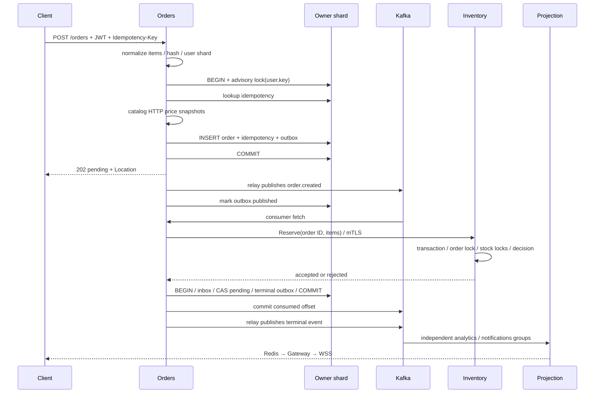

# Архитектурные решения и распределённые гарантии

## Жизненный цикл заказа

`pending` означает: запрос принят owning PostgreSQL, окончательного решения по запасам ещё нет. `confirmed` означает: все items зарезервированы. `rejected` означает: ни один item этого заказа не списан. Нет состояния «частично подтверждён». В данной версии нельзя отменить confirmed заказ и нет automatic reservation expiry.

## Таблица crash windows

| Момент сбоя | Что уже durable | Как восстанавливаемся |
|---|---|---|
| До checkout commit | ничего или незавершённая транзакция | rollback, retry с прежним ключом |
| После commit до HTTP response | order + idempotency + outbox | retry находит исходный order, не переписывает цены |
| До Kafka publish | outbox row | relay повторяет после восстановления broker |
| После Kafka ack до outbox mark | broker record + pending outbox | повтор той же event ID; consumers обязаны дедуплицировать |
| После inventory commit до RPC response | stock change + reservation decision | тот же order ID возвращает прежний результат |
| После inventory success до Orders update | reservation существует; order pending | новый consumer повторяет reserve и завершает transition |
| После Orders terminal commit до Kafka offset commit | terminal order + terminal outbox + inbox | повтор видит terminal state и не списывает stock |
| После projection side effect до offset commit | index/doc/CH row/notification | index version, CH FINAL; WS допускает дубли |
| Во время WS delivery | заказ сохранён, уведомление может пропасть | reconnect/periodic REST snapshot |

Распределённый timeout означает **неизвестный результат**, а не доказательство rollback. Поэтому retry использует тот же business identifier. Автоматический возврат денег/остатков после timeout здесь был бы ошибкой: reserve мог уже commit. Решение — forward recovery по стабильному order ID.

## ADR-001. Database ownership и service boundaries

**Решение:** Identity/Catalog/Inventory/Orders имеют собственные tables/database roles. Только owner меняет состояние. Transport adapters обращаются к use case/service; SQL остаётся рядом с доменной операцией, чтобы границы транзакции были очевидны.

**Альтернатива:** shared schema и cross-service joins. Она проще первоначально, но создаёт coupling схемы/релизов, превращает права БД в неявный API и делает отдельный deployment рискованным.

**Последствия:** у Orders нет FK на Identity пользователя или Catalog товар. Их глобальную целостность нельзя обеспечить одним SQL constraint. На входе проверяются JWT и quote; резерв проверяется Inventory. Межсервисные deletes потребуют собственного workflow. Shared PG host в dev не отменяет логическую ownership, но остаётся общей точкой отказа.

## ADR-002. Outbox вместо DB + broker dual write

**Решение:** event payload записывается в той же локальной транзакции, что и изменение агрегата. Relay читает ограниченную пачку `FOR UPDATE SKIP LOCKED`, публикует с `acks=all` и помечает строки опубликованными.

**Альтернатива:** сначала INSERT order, затем Kafka send. Crash между ними теряет событие. Обратный порядок создаёт событие несуществующего заказа. Distributed transaction/2PC усложняет доступность и поддерживается не всеми участниками.

**Последствия:** at least once; relay удерживает SQL locks на время сети и ограничен batch/deadline. Это сознательное упрощение; при большом потоке разумны leases либо CDC/Debezium. `SKIP LOCKED` допускает конкурентные relay replicas, но не гарантирует publication order одного aggregate между ними. Поэтому versioned projections обязательны; текущая saga реагирует только на immutable `order.created`, terminal transition выполняется CAS.

## ADR-003. Асинхронная state machine вместо синхронной цепочки

**Решение:** HTTP checkout ждёт только own DB и price quote, но не inventory RPC, search, analytics или websocket. Orders consumer оркестрирует reserve и собственный terminal transition.

**Альтернатива:** блокировать HTTP до всех downstream side effects. Удлиняется критический путь, множатся таймауты и неоднозначные результаты.

**Последствия:** пользователь видит pending. Это не полная payment saga с compensation, а минимальный двухшаговый workflow с forward recovery. Когда появится payment provider, нужен явный authorization/capture/refund protocol, reservation expiry/release и reconciliation. Добавлять `Release` без идемпотентной модели reservation state нельзя.

## ADR-004. User-based physical shards, topology v1

**Решение:** `FNV1a32(user_id) % 2`, отдельные DSN/volumes, все write-side records пользователя на его shard. Внешний customer API требует authenticated user, поэтому scatter/gather для GET order не нужен. Префикс ID полезен для диагностики, но запрос всё равно ограничен owner.

**Почему не random order shard:** заказов распределилось бы ровнее, но list-user-orders требовал бы fanout на каждый shard и merge pagination. User-based colocating упрощает транзакционную idempotency и customer access.

**Почему не tenant-controlled key:** клиент не задаёт user ID и не может произвольно направить запись. Случайно назначенные сервером IDs распределяются достаточно равномерно; тест фиксирует функцию, но статистический тест не доказывает равномерность реальной бизнес-нагрузки.

**Ограничения:** один активный пользователь создаёт нагрузку одному shard; один shard outage блокирует его пользователей. Users одного shard не могут «временно» писать в другой: это сломает ownership/idempotency. На отказ возвращаем `503`, а не создаём вторую копию заказа.

### План перехода на большее число shards

В этой версии не реализован. Безопасный следующий дизайн:

1. Ввести много virtual buckets и versioned mapping `bucket → physical shard` либо user directory. Зафиксировать epoch маршрутизации; rollout сначала должен уметь читать старую и новую topology.
2. Выбрать bucket, запретить/дренировать его writes или включить согласованный transfer protocol. Нельзя допустить two active writers для одного owner.
3. Перенести orders, idempotency, inbox, outbox и published metadata совместно. Backfill snapshot сам по себе не переносит изменения после snapshot; нужен WAL/CDC catch-up или bounded write freeze.
4. Дождаться нулевого lag, проверить counts/checksums/business invariants и состояние in-flight reservations.
5. Атомарно переключить directory epoch и fencing token. Старый owner должен отклонять writes новой эпохи, даже если его cache устарел.
6. Оставить read fallback/rollback window, исключить двойной relay для перенесённых outbox, затем вывести старые данные из обслуживания.

Простая замена `% 2` на `% 4` меняет владельца части пользователей без переноса данных и запрещена тестом topology. На первом этапе допустима offline migration с maintenance window: она проще и честнее ненадёжного «online resharding».

## ADR-005. CQRS projections, не event sourcing

PostgreSQL хранит текущую истину; Kafka доставляет integration events. OpenSearch/ClickHouse — read models. Удаление индекса не удаляет продукты; его можно восстановить snapshot + последующими событиями. Но Kafka retention ограничен, поэтому нельзя гарантировать rebuild всей истории только из Kafka. Для полного rebuild нужен экспорт owner DB и cutover по watermark/version либо долговременный event archive.

ClickHouse `ReplacingMergeTree` дедуплицирует в merge; summary явно использует `FINAL`. Нельзя перенести raw stream прямо в обычный Summing materialized view и считать, что повторов нет: дубли могли уже войти в агрегат до merge.

Search применяется с external version, поэтому более старый event не заменит новый product. Event time не используется как logical version: clocks разных узлов могут расходиться. Для одного aggregate version увеличивает owner в SQL.

## ADR-006. Best-effort live stream + authoritative snapshots

Redis Pub/Sub и WS уменьшают latency UI, но не являются журналом заказов. Hub имеет queue 32 на соединение; при переполнении уведомление пропускается. UI сравнивает version и перечитывает последние 50 orders каждые 15 секунд/при reconnect. REST не может восстановить полную бесконечную историю: pagination пока отсутствует.

Fanout через `PSubscribe notify:*` прост: каждая Gateway replica получает все уведомления и отправляет локальным пользователям. Это O(number of gateways × event rate). Для крупного realtime-сервиса нужны presence directory, адресная маршрутизация и durable per-user sequence/resume cursor. Активные WS connections сейчас не имеют отдельной server-side quota; IP request limit ограничивает ticket issuance, но не заменяет connection admission control.

## Согласованность, CAP и доступность

- Local PostgreSQL transaction даёт атомарность соответствующей операции; между сервисами атомарности нет.
- При Kafka outage checkout может продолжать принимать pending заказы до лимитов DB/backlog. HTTP `202` не означает успешный reserve.
- При Inventory outage pending сохраняется, retries растят lag. Продолжать «подтверждать» без authoritative stock нельзя.
- При Order shard outage write/read его владельцев закрываются. Второй shard технически доступен, но общий `/readyz` Orders проверяет оба: в Kubernetes отказ одного может убрать все Orders pods из readiness. Это сознательно простая coarse readiness; для partial availability нужны per-shard routing/health и отдельная readiness policy.
- При Search outage чтение каталога и checkout не используют OpenSearch; search возвращает `503`. Однако общий Projection readiness привязан к Search и CH, поэтому K8s read API имеет общий failure domain. Consumers внутри процесса продолжают отдельные retries.
- При Redis outage gateway fail-closed rate limiting делает public API недоступным. DB/Kafka сохраняют уже принятые данные.

Нельзя приклеить всему стеку одну метку «CP» или «AP»: решение принимается для каждой операции и конкретной partition. Здесь stock correctness ставится выше возможности немедленно подтверждать заказ.

## Backpressure и capacity boundaries

DB pool <=12 connections на service/shard; Orders имеет 4 consumer members, Projection — по одному на read model. Один reader последовательно обрабатывает полученные сообщения, сохраняя понятную модель offset commit. Максимальный параллелизм ограничен partitions/group members, а не числом goroutines в HTTP.

Ретраи не создают по goroutine на каждую ошибку. Это ограничивает ресурсы, но блокирует assigned partitions. При росте lag масштабирование consumers помогает до насыщения Inventory/DB/partition count. Горячий stock row остаётся serial bottleneck; больше Orders replicas не увеличивает throughput этого SKU.

Возможное развитие hot-SKU: заранее распределённые inventory buckets/escrow tokens по региону или sale workers с единственным writer на SKU. Это требует явной модели transfer/reconciliation; «кешировать stock в Redis и уменьшать без записи» не является безопасной заменой текущей транзакции.

## Совместимость контрактов

Envelope имеет schema=1. Не удалять и не переиспользовать Protobuf field numbers; новый optional field допустим при сохранении старых consumers. HTTP добавления следует сопоставлять со strict decoder: клиентские request fields нельзя добавлять до rollout поддерживающих servers. Изменение семантики денег/status требует новой version/event type и периода совместного обслуживания. Автоматической Schema Registry проверки в текущем pipeline нет.
